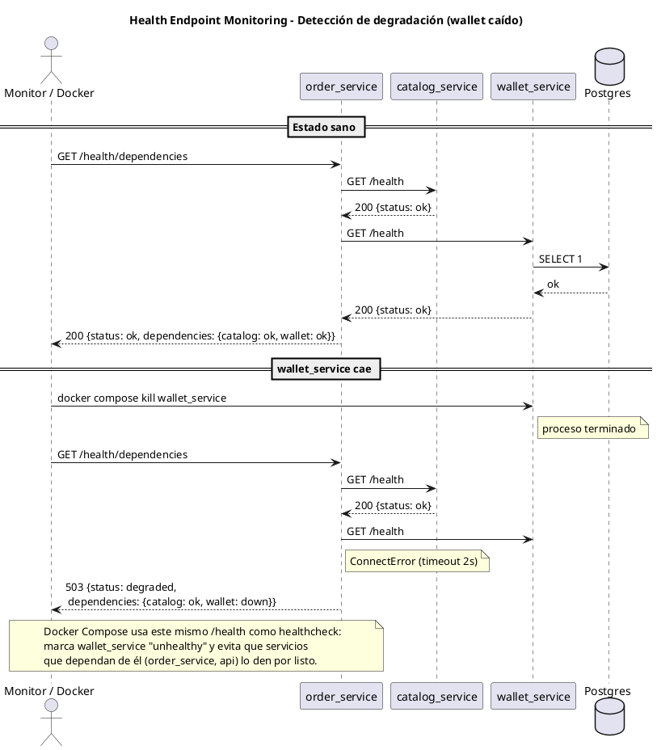
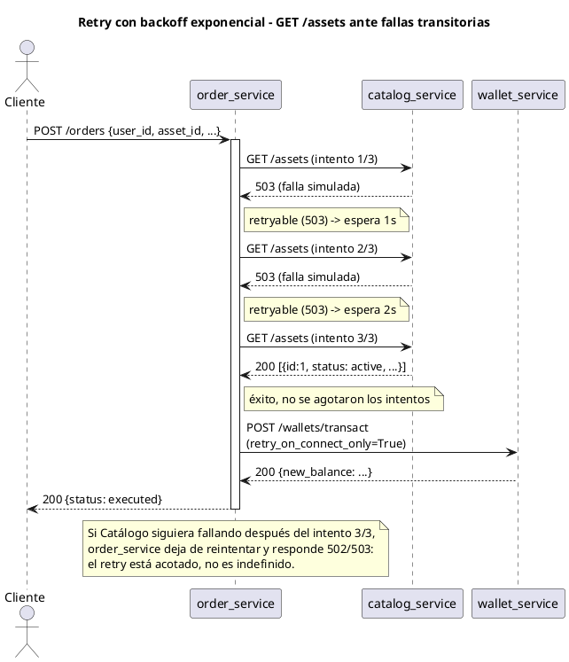

# TFU UT4 — Patrones de Arquitectura (InvestNow)

> Documento de entrega de la **Unidad Temática 4**, incremental sobre
> [`../UT3/ENTREGA.md`](../UT3/ENTREGA.md) (microservicios: Catálogo,
> Wallet, Órdenes) y sobre el contexto de negocio y requerimientos de
> [`../UT1/ENTREGA.md`](../UT1/ENTREGA.md). Para la visión general del
> proyecto y cómo levantar el stack completo, ver el
> [`README.md`](../../README.md) de la raíz.

Trabajo Final de la Unidad Temática 4 (Patrones de Arquitectura). Este
documento contiene modelos UML, la explicación de cómo cada patrón
logra el atributo de calidad correspondiente, y cómo comprobarlo mediante
pruebas empíricas.

## 0. Alcance y encuadre

Como InvestNow ya está implementado con microservicios resultantes de una
partición de dominio de primer nivel (Catálogo, Wallet, Órdenes — ver
[`../UT3/ENTREGA.md`](../UT3/ENTREGA.md), sección 3), aplica la excepción
de la letra de UT4: se puede omitir el grupo de patrones de facilidad de
modificación y despliegue, quedando **6 patrones en total** en vez de 7 (2
de disponibilidad + 2 de rendimiento + 2 de seguridad).

Dentro de cada grupo, la elección de patrones prioriza los que mejor se
integran al código y a la infraestructura ya existentes, sin requerir
componentes nuevos (broker de mensajes, cache, etc.) cuando eso alcanza
para demostrar el atributo de calidad correspondiente. Para el **grupo de
disponibilidad** se eligieron:

- **Health Endpoint Monitoring**
- **Retry**

## 1. Health Endpoint Monitoring

### 1.1 Atributo de calidad y problema que resuelve

Antes de esta entrega, ningún servicio exponía su estado: un orquestador
(o un operador humano) solo podía inferir que algo andaba mal cuando una
request de negocio real fallaba. Eso es tarde — especialmente para
`wallet_service`, cuya única responsabilidad depende enteramente de que
Postgres esté accesible, y para `order_service`, que depende a su vez de
`catalog_service` y de `wallet_service` (ver el diagrama de componentes de
UT3). El patrón **Health Endpoint Monitoring** ataca directamente
**disponibilidad**: permite detectar una dependencia caída o degradada
*antes* de que llegue una orden real, y permite que el propio orquestador
(Docker Compose) condicione el arranque de un servicio a que sus
dependencias estén realmente sanas, no solo "iniciadas".

### 1.2 Diseño implementado

Se agregó un módulo reutilizable, `app/routers/health_router.py`, con una
factory `build_health_router(service_name, liveness_check=None,
dependency_check=None)` usada por los cuatro `*_main.py`. Expone dos
niveles, según si el servicio tiene una dependencia propia y según si
depende de otros servicios de la plataforma:

| Servicio | `GET /health` | `GET /health/dependencies` |
|---|---|---|
| `api` | shallow (proceso vivo) | — |
| `catalog_service` | shallow (sin dependencias propias) | — |
| `wallet_service` | **profundo**: ejecuta `SELECT 1` contra Postgres | — |
| `order_service` | shallow (proceso vivo) | **profundo**: `GET /health` a Catálogo y a Wallet, agrega el resultado |

`order_service` es el único con `/health/dependencies` porque es el único
componente que depende de *otros servicios de la plataforma* (Catálogo y
Wallet); `wallet_service` resuelve su única dependencia externa (Postgres)
directamente en su propio `/health`, sin necesitar un endpoint separado.

Estos mismos endpoints se cablearon como `healthcheck:` de cada servicio
en `docker-compose.yaml` (usando `python -c "import urllib.request; ..."`
en vez de `curl`, para no agregar esa dependencia a las imágenes slim), y
`order_service`/`api` ahora usan `depends_on: condition: service_healthy`
en vez de solo esperar a que el contenedor exista: `order_service` no se
considera listo hasta que Catálogo y Wallet respondan en sus `/health`, y
`api` no arranca hasta que las tres piezas de negocio estén sanas.

### 1.3 Diagrama de secuencia (UML)

Caso: `wallet_service` cae mientras `order_service` sigue corriendo.
Pegar en https://editor.plantuml.com para visualizarlo.



### 1.4 Cómo se comprueba empíricamente

`scripts/demo_ut4_health.sh`:

1. Consulta `GET /health` de los 4 servicios → los 4 responden `200 ok`.
2. Consulta `GET /health/dependencies` en `order_service` → `200`, ambas
   dependencias `ok`.
3. Mata `wallet_service` (`docker compose kill`).
4. `GET /health` directo a `wallet_service` → falla (conexión rechazada):
   el contenedor está abajo.
5. `GET /health/dependencies` en `order_service` → **503**, con
   `wallet: down` y `catalog: ok`: la degradación de una sola dependencia
   se refleja sin afectar el reporte de la otra.
6. `docker compose ps` → la columna de estado de `wallet_service` lo
   muestra como no saludable/caído.
7. Se levanta `wallet_service` de nuevo y se espera a que el healthcheck
   lo marque `healthy`.
8. `GET /health/dependencies` en `order_service` → vuelve a `200 ok`.

```bash
bash scripts/demo_ut4_health.sh
```

## 2. Retry

### 2.1 Atributo de calidad y problema que resuelve

`order_service` depende de dos llamadas salientes síncronas (a Catálogo y
a Wallet). Antes de esta entrega, cualquier falla transitoria de red —un
timeout puntual, un 503 momentáneo mientras una dependencia recién
arranca— hacía fallar la orden en el primer intento, aunque la dependencia
estuviera disponible un instante después. El patrón **Retry** ataca
**disponibilidad**: absorbe fallas transitorias reintentando la operación
un número acotado de veces con backoff exponencial, evitando que un
problema momentáneo y recuperable se traduzca en una orden fallida.

### 2.2 Diseño implementado

Módulo nuevo `app/resilience/retry.py`, con `call_with_retry(method, url,
retry_on_connect_only=False, **kwargs)`: hasta `MAX_ATTEMPTS = 3` intentos,
backoff exponencial (`1s`, `2s` entre intentos), reintentando ante
`httpx.ConnectError`, timeouts y respuestas `502/503/504`.

Se integra en los dos puntos de `order_router.py` que llaman a otros
servicios, **con una distinción deliberada**:

- `GET /assets` (Catálogo) → retry completo. Es una consulta de solo
  lectura, **idempotente**: repetirla no tiene efecto colateral.
- `POST /wallets/transact` (Wallet) → `retry_on_connect_only=True`. Es un
  **débito de saldo, no-idempotente**. Si la conexión nunca se estableció
  (`ConnectError`), el servidor nunca vio el pedido y reintentar es
  seguro. Pero si el pedido se envió y lo que falló fue esperar la
  respuesta (`ReadTimeout`), el servidor pudo haber aplicado el débito
  igual: reintentar a ciegas en ese caso arriesgaría debitar dos veces,
  exactamente el riesgo que UT1 identifica en
  [**ASR-05 — Prevención de órdenes duplicadas**](../UT1/ENTREGA.md).
  Por eso ese caso **no** se reintenta: se prefiere fallar la orden (y que
  el usuario reintente explícitamente desde el cliente) antes que arriesgar
  un doble débito silencioso.

Para poder demostrar el patrón de forma determinística (reiniciar un
contenedor real tarda segundos, mucho más que el backoff de 1-2s, así que
el reintento real casi nunca llegaría a tiempo en un script), se agregó un
endpoint de *fault injection* solo para esta demo en `catalog_service`:
`POST /api/v1/_debug/fail-next/{n}`, que hace que las próximas `n`
llamadas a `GET /assets` devuelvan `503` antes de volver a responder
normalmente. El mismo criterio de "mocks estables" que UT3 ya documentó
para simplificar integraciones externas.

### 2.3 Diagrama de secuencia (UML)

Caso: Catálogo falla transitoriamente 2 veces y se recupera al 3er
intento (dentro del límite). Pegar en https://editor.plantuml.com.



### 2.4 Cómo se comprueba empíricamente

`scripts/demo_ut4_retry.sh`:

1. **Caso dentro del límite:** `POST /_debug/fail-next/2` en Catálogo →
   `POST /orders` en `order_service`. La orden se completa igual (`200`,
   `status: executed`) pese a las 2 fallas simuladas. Los logs de
   `order_service` muestran las líneas `[retry] intento 1/3 ...` y
   `[retry] intento 2/3 ...` antes de la respuesta final exitosa.
2. **Caso que agota los reintentos:** `POST /_debug/fail-next/5` (más
   fallas que `MAX_ATTEMPTS=3`) → la siguiente orden falla con `502/503`:
   prueba que el patrón no reintenta indefinidamente, solo absorbe fallas
   transitorias acotadas.
3. Al finalizar, el script restaura el contador de fallas simuladas a `0`
   y el saldo del usuario 1 al valor original (el único de los dos casos
   que llegó a debitar fue el primero, ya que el segundo falla en el paso
   de Catálogo, antes de llegar a Wallet).

```bash
bash scripts/demo_ut4_retry.sh
```

