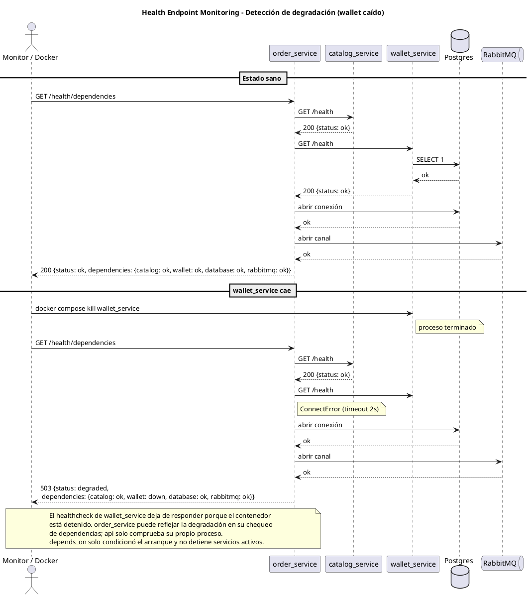
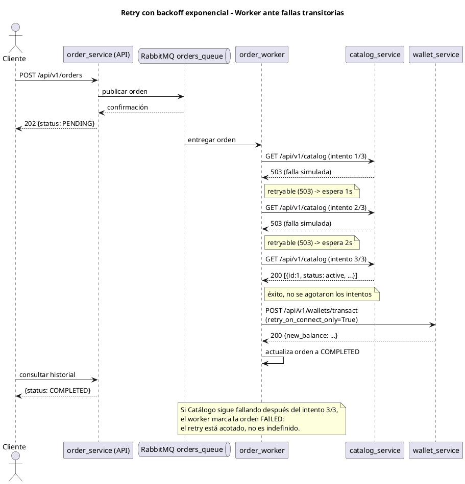
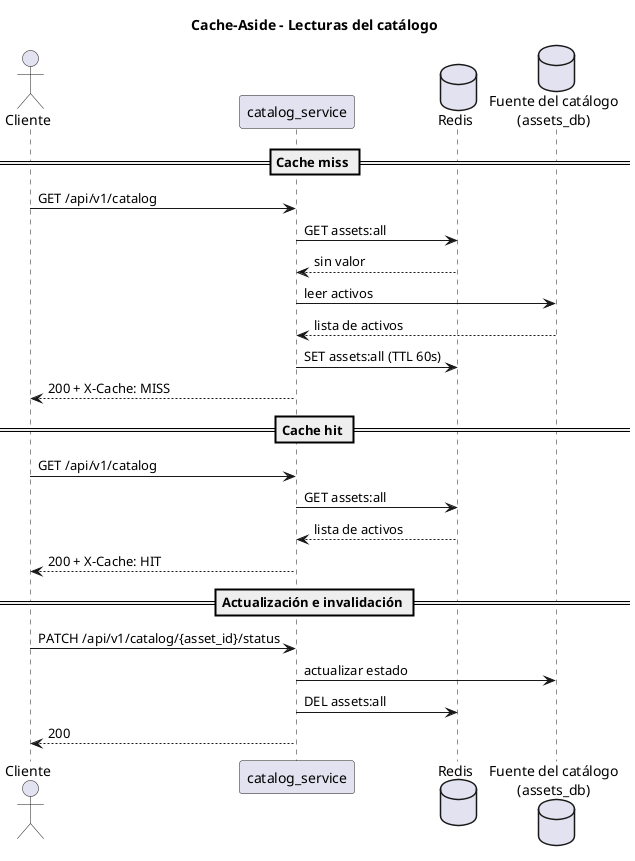
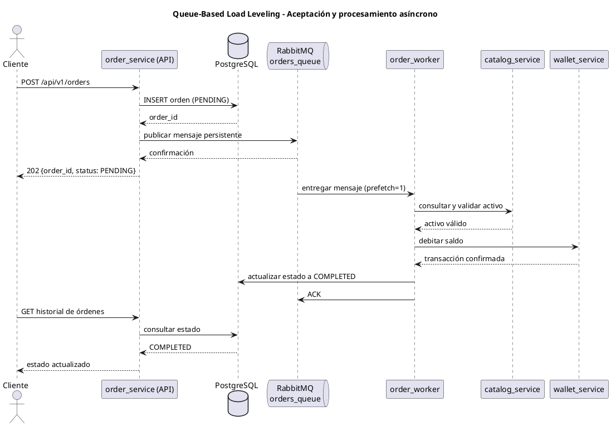
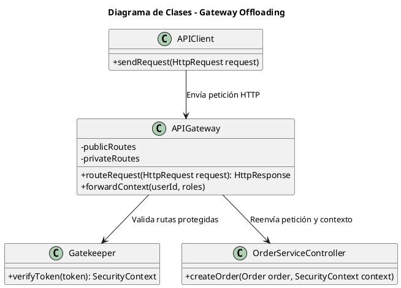
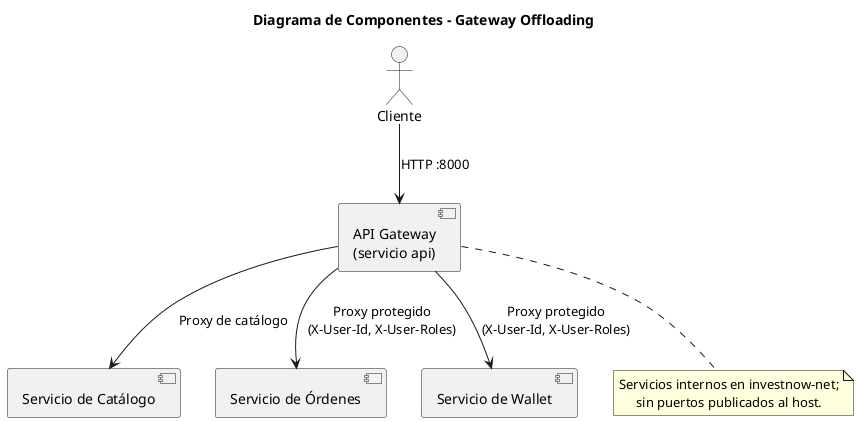
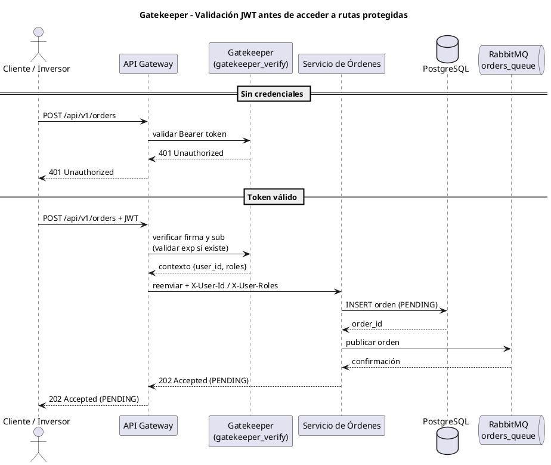
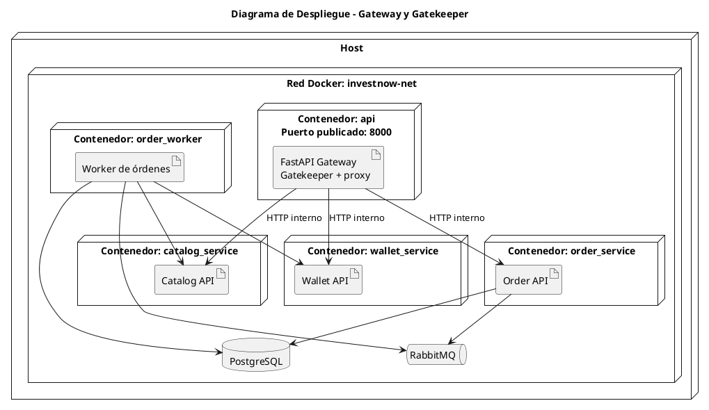

# TFU UT4 — Patrones de Arquitectura (InvestNow)

> Documento de entrega de la **Unidad Temática 4**, incremental sobre
> [`../UT3/ENTREGA.md`](../UT3/ENTREGA.md) (microservicios: Catálogo,
> Wallet, Órdenes) y sobre el contexto de negocio y requerimientos de
> [`../UT1/ENTREGA.md`](../UT1/ENTREGA.md). Para la visión general del
> proyecto y cómo levantar el stack completo, ver el
> [`README.md`](../../README.md) de la raíz.

Trabajo Final de la Unidad Temática 4 (Patrones de Arquitectura). Este
documento contiene modelos UML, la explicación de cómo cada patrón
logra el atributo de calidad correspondiente, y cómo comprobarlo mediante
pruebas empíricas. La consigna se resuelve con seis patrones: dos de
disponibilidad, dos de rendimiento y dos de seguridad. Este documento
reúne la explicación de los seis patrones.

## 0. Alcance y encuadre

Como InvestNow ya está implementado con microservicios resultantes de una
partición de dominio de primer nivel (Catálogo, Wallet, Órdenes — ver
[`../UT3/ENTREGA.md`](../UT3/ENTREGA.md), sección 3), aplica la excepción
de la letra de UT4: se puede omitir el grupo de patrones de facilidad de
modificación y despliegue, quedando **6 patrones en total** en vez de 7 (2
de disponibilidad + 2 de rendimiento + 2 de seguridad).

La selección cubre los tres atributos requeridos por la consigna y se
integra con los servicios existentes. Para **disponibilidad** se eligieron:

- **Health Endpoint Monitoring**
- **Retry**

Para **rendimiento** se eligieron:

- **Cache-Aside**
- **Queue-Based Load Leveling**

Para **seguridad** se eligieron:

- **Gateway Offloading**
- **Gatekeeper**

## 1. Health Endpoint Monitoring

### 1.1 Atributo de calidad y problema que resuelve

Antes de esta entrega, ningún servicio exponía su estado: un orquestador
(o un operador humano) solo podía inferir que algo andaba mal cuando una
request de negocio real fallaba. Eso es tarde — especialmente para
`wallet_service`, cuya única responsabilidad depende enteramente de que
Postgres esté accesible, y para `order_service`, que depende a su vez de
`catalog_service` y de `wallet_service` (ver el diagrama de componentes de
UT3). El patrón **Health Endpoint Monitoring** ataca directamente
**disponibilidad**: permite detectar una dependencia caída o degradada
*antes* de que llegue una orden real, y permite que el propio orquestador
(Docker Compose) condicione el arranque de un servicio a que sus
dependencias estén realmente sanas, no solo "iniciadas".

### 1.2 Diseño implementado

Se agregó un módulo reutilizable, `app/routers/health_router.py`, con una
factory `build_health_router(service_name, liveness_check=None,
dependency_check=None)` usada por los cuatro `*_main.py`. Expone dos
niveles, según si el servicio tiene una dependencia propia y según si
depende de otros servicios de la plataforma:

| Servicio | `GET /health` | `GET /health/dependencies` |
|---|---|---|
| `api` | shallow (proceso vivo) | — |
| `catalog_service` | shallow (sin dependencias propias) | — |
| `wallet_service` | **profundo**: ejecuta `SELECT 1` contra Postgres | — |
| `order_service` | shallow (proceso vivo) | **profundo**: comprueba Catálogo, Wallet, PostgreSQL y RabbitMQ |

`order_service` es el único con `/health/dependencies` porque es el único
que agrega el estado de sus dependencias directas. Comprueba Catálogo,
Wallet, PostgreSQL y RabbitMQ; `wallet_service` valida PostgreSQL en su
propio `/health`, porque es una dependencia imprescindible para sus
operaciones.

Estos mismos endpoints se cablearon como `healthcheck:` de cada servicio
en `docker-compose.yaml` (usando `python -c "import urllib.request; ..."`
en vez de `curl`, para no agregar esa dependencia a las imágenes slim), y
`order_service`/`api` ahora usan `depends_on: condition: service_healthy`
en vez de solo esperar a que el contenedor exista. Esto condiciona el
orden de arranque: `order_service` espera a que sus dependencias estén
sanas y `api` espera a los servicios de negocio. `depends_on` no es un
mecanismo de recuperación ni detiene automáticamente servicios que ya
están ejecutándose si una dependencia cae después.

### 1.3 Diagrama de secuencia (UML)

Caso: `wallet_service` cae mientras `order_service` sigue corriendo.
Pegar en https://editor.plantuml.com para visualizarlo.



### 1.4 Cómo se comprueba empíricamente

`scripts/demo_ut4_health.sh`:

1. Consulta `GET /health` de los 4 servicios → los 4 responden `200 ok`.
2. Consulta `GET /health/dependencies` en `order_service` → `200` cuando
   Catálogo, Wallet, PostgreSQL y RabbitMQ están disponibles.
3. Mata `wallet_service` (`docker compose kill`).
4. `GET /health` directo a `wallet_service` → falla (conexión rechazada):
   el contenedor está abajo.
5. `GET /health/dependencies` en `order_service` → **503**, con
   `wallet: down`; los resultados de las demás dependencias también se
   informan por separado.
6. `docker compose ps` → `wallet_service` figura como detenido.
7. Se levanta `wallet_service` de nuevo y se espera a que el healthcheck
   lo marque `healthy`.
8. `GET /health/dependencies` en `order_service` → vuelve a `200 ok`.

```bash
bash scripts/demo_ut4_health.sh
```

## 2. Retry

### 2.1 Atributo de calidad y problema que resuelve

El worker de órdenes realiza llamadas salientes a Catálogo y Wallet. Una
falla transitoria de red o un `503` momentáneo puede impedir completar una
orden aunque la dependencia vuelva a estar disponible enseguida. El
patrón **Retry** mejora la **disponibilidad** reintentando ciertas
operaciones un número acotado de veces, con backoff exponencial, para
absorber fallas transitorias recuperables.

### 2.2 Diseño implementado

Módulo `app/resilience/retry.py`, con `call_with_retry(method, url,
retry_on_connect_only=False, **kwargs)`: hasta `MAX_ATTEMPTS = 3` intentos,
backoff exponencial (`1s`, `2s` entre intentos). En modo normal reintenta
ante errores de conexión, timeouts y respuestas `502/503/504`.

Se integra en las llamadas salientes de `app/order_processing.py`, que
ejecuta el proceso `order_worker`, **con una distinción deliberada**:

- `GET /api/v1/catalog` (Catálogo) → retry completo. Es una consulta de solo
  lectura, **idempotente**: repetirla no tiene efecto colateral.
- `POST /api/v1/wallets/transact` (Wallet) → `retry_on_connect_only=True`.
  Solo reintenta ante `ConnectError`, cuando la conexión no se estableció.
  No reintenta ante un timeout de lectura porque el débito podría haberse
  aplicado. La operación lleva `transaction_id=order:{order_id}` para que
  Wallet pueda reconocer una repetición del mismo débito, en línea con
  [**ASR-05 — Prevención de órdenes duplicadas**](../UT1/ENTREGA.md).

Para demostrar el patrón de forma determinística, se agregó en
`catalog_service` un endpoint de *fault injection* solo para esta demo:
`POST /api/v1/_debug/fail-next/{n}`. Hace que las próximas `n` consultas
al catálogo devuelvan `503`.

### 2.3 Diagrama de secuencia (UML)

Caso: Catálogo falla transitoriamente 2 veces y se recupera al 3er
intento (dentro del límite). Pegar en https://editor.plantuml.com.



### 2.4 Cómo se comprueba empíricamente

`scripts/demo_ut4_retry.sh`:

1. **Caso dentro del límite:** se simulan 2 fallas transitorias en
   Catálogo y se encola una orden. La API responde `202`; luego el worker
   reintenta la consulta y el historial muestra la orden como
   `COMPLETED`. Los logs de `order_worker` muestran los reintentos.
2. **Caso que agota los reintentos:** se simulan 5 fallas, más que los
   `MAX_ATTEMPTS=3`; el worker marca la orden `FAILED` tras tres intentos.
3. Al finalizar, el script deja el contador de fallas en `0` y fija el
   saldo del usuario 1 en `10000.00` (no guarda ni restaura el saldo
   previo).

```bash
bash scripts/demo_ut4_retry.sh
```

## 3. Cache-Aside

### 3.1 Atributo de calidad y problema que resuelve

El patrón **Cache-Aside** mejora el **rendimiento** de las consultas
repetidas al catálogo. Sin una cache, cada lectura debe recuperar y
serializar los activos desde la fuente del servicio. Como esas lecturas
son frecuentes y los datos del catálogo cambian con menor frecuencia, se
puede reutilizar temporalmente el resultado para reducir el trabajo de la
fuente y el tiempo de respuesta de las consultas siguientes.

### 3.2 Diseño implementado

`catalog_service` usa Redis como cache compartida. En `GET /api/v1/catalog`,
el servicio primero busca la clave `assets:all`. Si encuentra un valor
JSON válido, responde con esos datos y la cabecera `X-Cache: HIT`. Si no
hay valor, obtiene los activos de `assets_db`, intenta guardarlos en Redis
con un TTL de 60 segundos y responde `X-Cache: MISS`.

Al modificar el estado de un activo con `PATCH /api/v1/catalog/{asset_id}/status`,
se invalida `assets:all`; la siguiente consulta vuelve a cargar el
catálogo actualizado. Si Redis no está disponible o su entrada no es
válida, el servicio registra una advertencia y responde desde la fuente
del catálogo: la cache acelera las lecturas, pero no es imprescindible
para servirlas.

En esta implementación la fuente `assets_db` es una estructura en
memoria, propia de cada réplica, y se usa para la demo. Redis es
compartido; esto no convierte a la fuente en persistente ni resuelve la
consistencia de escrituras entre réplicas.

### 3.3 Diagrama de secuencia (UML)

Caso: primera lectura sin entrada en cache, seguida de una lectura que
encuentra la entrada. Pegar en https://editor.plantuml.com.



### 3.4 Cómo se comprueba empíricamente

`scripts/demo_ut4_cache_aside.sh` consulta el catálogo 100 veces y registra
para cada respuesta el valor de `X-Cache` y su latencia. Al final informa
la cantidad de `HIT`, `MISS`, errores y las latencias promedio de ambos
casos. Así se puede comprobar que la aplicación identifica los aciertos
y las cargas desde la fuente, y comparar sus tiempos observados en esa
ejecución.

```bash
bash scripts/demo_ut4_cache_aside.sh
```

La invalidación se verifica además modificando el estado de un activo y
consultando el catálogo: el `PATCH` elimina la entrada compartida y la
lectura siguiente debe mostrar el cambio desde la fuente y reconstruir la
cache.

## 4. Queue-Based Load Leveling

### 4.1 Atributo de calidad y problema que resuelve

El patrón **Queue-Based Load Leveling** mejora el **rendimiento bajo
picos de carga** y desacopla la recepción de órdenes de su procesamiento.
Si la API ejecutara de manera sincrónica todas las validaciones y llamadas
a Catálogo y Wallet antes de responder, cada petición mantendría recursos
ocupados durante todo ese trabajo; una ráfaga de órdenes podría aumentar
la latencia o saturar los servicios dependientes.

La cola absorbe temporalmente esa ráfaga y permite procesar las órdenes a
un ritmo controlado. La aceptación rápida no significa que la orden ya
se haya ejecutado: el cliente recibe `202 Accepted` y estado `PENDING`,
que cambia a `COMPLETED` o `FAILED` cuando el worker termina el
procesamiento.

### 4.2 Diseño implementado

Al recibir `POST /api/v1/orders`, `order_service` persiste primero la
orden con estado `PENDING` en PostgreSQL y luego publica su identificador,
usuario y contenido en la cola durable `orders_queue` de RabbitMQ. El
mensaje se publica como persistente y con confirmación del broker. Si no
se puede publicar, la orden queda marcada `FAILED` y la API responde
`503`, en vez de informar que fue aceptada.

El proceso separado `order_worker` consume la cola con
`prefetch_count=1` y confirmación manual (`auto_ack=False`). Procesa cada
orden contra Catálogo y Wallet, guarda el estado final en PostgreSQL y
confirma el mensaje al broker. Si no logra persistir el resultado,
rechaza el mensaje con reencolado para no perderlo. El endpoint de
historial permite consultar el estado de las órdenes aceptadas.

La escritura de la orden en PostgreSQL y su publicación en RabbitMQ son
dos operaciones separadas, no una transacción atómica. Si el proceso cae
entre ambas, puede quedar una orden `PENDING` que no llegó a la cola; esta
demo no implementa el patrón Transactional Outbox.

El worker de esta configuración procesa una orden a la vez. Se puede
escalar el consumo con más workers, pero el patrón no implica capacidad
infinita: si la llegada supera sostenidamente la capacidad de
procesamiento, la cola crecerá y aumentará el tiempo hasta completar las
órdenes.

### 4.3 Diagrama de secuencia (UML)

Caso: la API acepta y encola una orden; el worker la procesa de manera
asíncrona. Pegar en https://editor.plantuml.com.



### 4.4 Cómo se comprueba empíricamente

`scripts/demo_ut4_queue_leveling.sh` envía por defecto 200 órdenes con
concurrencia 200. Comprueba que cada solicitud se acepta con HTTP `202`,
estado `PENDING` e identificador único; luego consulta el historial hasta
que todas terminan. La salida informa la latencia promedio, p50 y p95 de
aceptación, el tiempo de drenaje, el ritmo observado y los estados
finales.

```bash
bash scripts/demo_ut4_queue_leveling.sh
```

La medición separa explícitamente el tiempo de aceptación del tiempo de
procesamiento total. Es una demostración del desacoplamiento y del
drenaje de una ráfaga, no un benchmark A/B contra una implementación
sincrónica. El script crea órdenes persistidas y, si se completan, debita
el importe configurado de la wallet del usuario indicado.

## 5. Gateway Offloading

### 5.1 Atributo de calidad y problema que resuelve

El patrón **Gateway Offloading** aporta a la **seguridad** al concentrar
en el API Gateway la recepción, el ruteo de las solicitudes protegidas y
la propagación del contexto de identidad validado. Sin esa fachada, los
clientes tendrían que conocer y acceder directamente a los microservicios
internos, y cada servicio tendría que resolver por separado parte del
enrutamiento y del contexto de la petición.

En esta implementación el gateway también ofrece una ruta pública al
catálogo, mientras exige autenticación para las rutas privadas de órdenes
y Wallet. No se implementan aquí terminación TLS ni limitación de tasa
(rate limiting); no deben considerarse capacidades demostradas por esta
entrega.

### 5.2 Diseño implementado

El proxy está implementado en `app/routers/gateway_router.py` dentro del
servicio `api`. Para las rutas protegidas, el Gateway resuelve la URL del
servicio de destino, reenvía método, cuerpo y parámetros, y agrega
`X-User-Id` y `X-User-Roles` usando el contexto validado por Gatekeeper.
El catálogo dispone además de una ruta pública específica. Los endpoints
de salud también se exponen sin autenticación para permitir el monitoreo.

En Docker Compose, `api`, los microservicios, PostgreSQL y los brokers
comparten la red `investnow-net`; los puertos de los microservicios no se
publican al host. El Gateway no está desplegado en una DMZ o en una red
pública separada en esta configuración: el único puerto HTTP de la
aplicación publicado al host es el del servicio `api`.

Las cabeceras de identidad se propagan sobre la red interna, pero no están
firmadas criptográficamente. Los puertos de los servicios internos no se
publican al host, aunque otros procesos conectados a `investnow-net` sí
podrían alcanzarlos. Por eso, esta demo confía en los procesos de esa red;
en un sistema de producción habría que reforzar esa frontera.

### 5.3 Modelos UML

#### 5.3.1 Diagrama de clases



#### 5.3.2 Diagrama de componentes



### 5.4 Cómo se comprueba empíricamente

`scripts/demo_ut4_gateway.sh` obtiene un JWT, consulta el catálogo y la
Wallet a través del Gateway, crea una orden y consulta su historial. La
orden se acepta de forma asíncrona, por lo que su respuesta correcta es
`202 Accepted`; el estado final se consulta en el historial.

```bash
bash scripts/demo_ut4_gateway.sh
```

## 6. Gatekeeper

### 6.1 Atributo de calidad y problema que resuelve

El patrón **Gatekeeper** aporta a la **seguridad** al validar la identidad
antes de permitir el acceso a las rutas protegidas. Así evita que
peticiones sin credenciales válidas alcancen las operaciones de órdenes
y Wallet y proporciona al Gateway un contexto de usuario autenticado.
Contribuye a los requerimientos RNF-07 (confidencialidad) y RNF-08
(autenticación), sin sustituir las comprobaciones de autorización propias
de cada operación.

### 6.2 Diseño implementado

La dependencia `gatekeeper_verify` de `app/security/gatekeeper.py`
intercepta las rutas protegidas del Gateway. Extrae el token Bearer y
valida su firma con PyJWT y el algoritmo HS256; PyJWT comprueba la
expiración si el token incluye el claim `exp`, y el Gatekeeper requiere
el claim `sub`. Del token obtiene el identificador de usuario y los
roles; luego Gateway los propaga a los servicios internos en las
cabeceras `X-User-Id` y `X-User-Roles`. El login de demostración no agrega
actualmente un claim `exp`, por lo que esos tokens de ejemplo no expiran.

El login actual es una simulación con usuarios en memoria, no un
proveedor de identidad productivo. El catálogo, las rutas de salud y el
login son rutas públicas por diseño; las rutas protegidas sin credencial
válida responden `401`. La autorización por rol se comprueba donde
corresponde, por ejemplo, en la consulta administrativa de órdenes.

### 6.3 Diagrama de secuencia (UML)

Ilustra el rechazo de una solicitud sin token y el flujo válido para
crear una orden. Pegar en https://editor.plantuml.com.



### 6.4 Diagrama de despliegue

La topología representa el despliegue de Docker Compose actual: Gateway,
servicios internos y dependencias conectados a la misma red privada de
Docker; solo `api` publica un puerto HTTP al host.



### 6.5 Cómo se comprueba empíricamente

`scripts/demo_ut4_gatekeeper.sh` intenta crear una orden sin token y
comprueba que recibe `401`; después obtiene un JWT de prueba y verifica
que el Gateway acepta la solicitud autenticada con `202`.

```bash
bash scripts/demo_ut4_gatekeeper.sh
```
