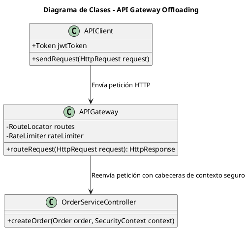
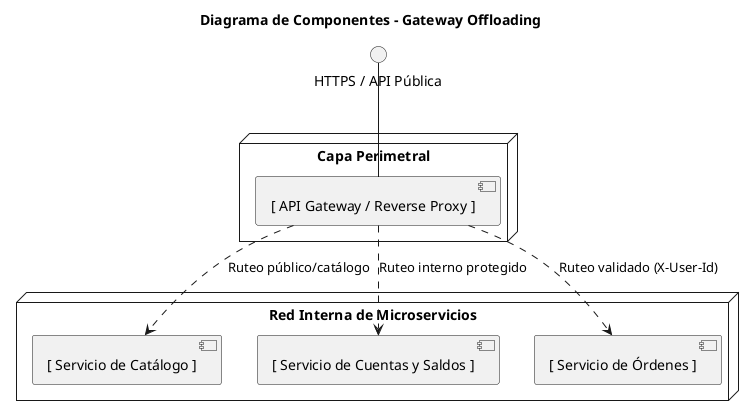
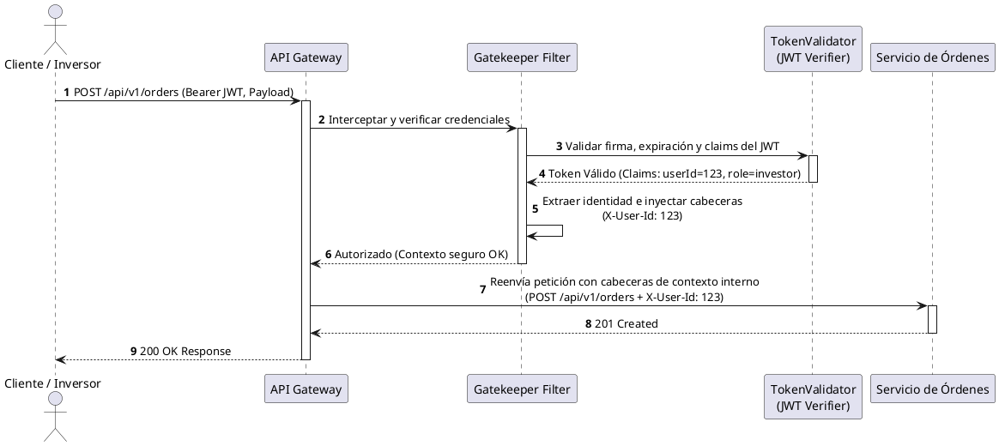

## 3. Gateway Offloading
### 3.1 Atributo de calidad y problema que resuelve

El patrón afecta directamente la **seguridad**. Antes de esta incorporación, los microservicios internos de negocio debían lidiar directamente con las peticiones de los clientes, exponiendo su topología y requiriendo configuraciones repetitivas de red. El patrón Gateway Offloading centraliza el punto de entrada de todas las peticiones, ocultando la topología interna de microservicios y aplicando políticas transversales de seguridad (como terminación TLS, limitación de tasa o rate limiting, validación de tokens e inyección de cabeceras de contexto seguro), dando cumplimiento al principio de Mínimo Privilegio y protección de la confidencialidad (RNF-07).

### 3.2 Modelos UML
#### 3.2.1 Diagrama de Clases

Muestra las clases del subsistema de enrutamiento perimetral.



#### 3.2.2 Diagrama de Componentes

Muestra cómo el API Gateway actúa como fachada única protegiendo la red privada interna.



### 3.3 Health Checks y Monitoreo
Se implementaron los controles de salud en el enrutamiento del Gateway para sortear el Gatekeeper y así facilitar el monitoreo de estado de los servicios internos, manteniendo su aislamiento.

### 3.4 Conclusión de Seguridad

El API Gateway actúa como una única fachada de entrada. Los microservicios internos no necesitan exponerse directamente a internet ni implementar lógica compleja de manejo de sesiones. Una vez procesada la entrada, el gateway inyecta cabeceras de contexto seguro firmadas (como `X-User-Id`), confiando únicamente en la red interna aislada (`investnow-net`).


## 4. Gatekeeper

### 4.1 Atributo de calidad y problema que resuelve

Esta implementación afecta directamente la **seguridad** de la aplicación. Para evitar que solicitudes no autorizadas o maliciosas alcancen los microservicios core (como OrderService o WalletService), el Gatekeeper actúa como el validador de identidad en la frontera, gestionando y verificando las credenciales antes de permitir el ingreso al perímetro interno, satisfaciendo los requerimientos RNF-07 (Confidencialidad) y RNF-08 (Autenticación robusta).

### 4.2 Modelos UML
#### 4.2.1 Diagrama de Secuencia

Ilustra el flujo temporal de interceptación y validación de identidad mediante JWT.



#### 4.2.2 Diagrama de Despliegue

Muestra la distribución física de los componentes de seguridad y la separación de redes en Docker.

```plantuml
@startuml
skinparam defaultTextAlignment center

title Diagrama de Despliegue - Perímetro Gatekeeper

node "Host / Servidor de Producción" {
    
    node "Red Pública / DMZ (investnow-public-net)" {
        container "Contenedor: api-gateway" {
            artifact "API Gateway / Gatekeeper\n(Validación JWT + Inyección Contexto)" as GatewayApp
        }
    }

    node "Red Privada Interna (investnow-net)" {
        container "Contenedor: order_service" {
            artifact "Python / FastAPI Order API" as OrderApp
        }
        database "Contenedor: postgres" {
            artifact "PostgreSQL Database" as DB
        }
    }
}

GatewayApp --> OrderApp : "Tráfico interno autorizado (X-User-Id)"
OrderApp --> DB : "Conexión segura ACID"

@enduml
```
### 4.3 Conclusión de Seguridad

El patrón Gatekeeper intercepta cada solicitud entrante antes de que toque la lógica de negocio de los microservicios. Al validar de forma centralizada la autenticidad e integridad de los tokens JWT (firma criptográfica, fecha de expiración y roles), asegura que ningún usuario no autenticado pueda ejecutar transacciones financieras o suplantar identidades.

Garantiza la Autenticación robusta y Autorización previa, reduciendo drásticamente la superficie de ataque expuesta por los microservicios internos.