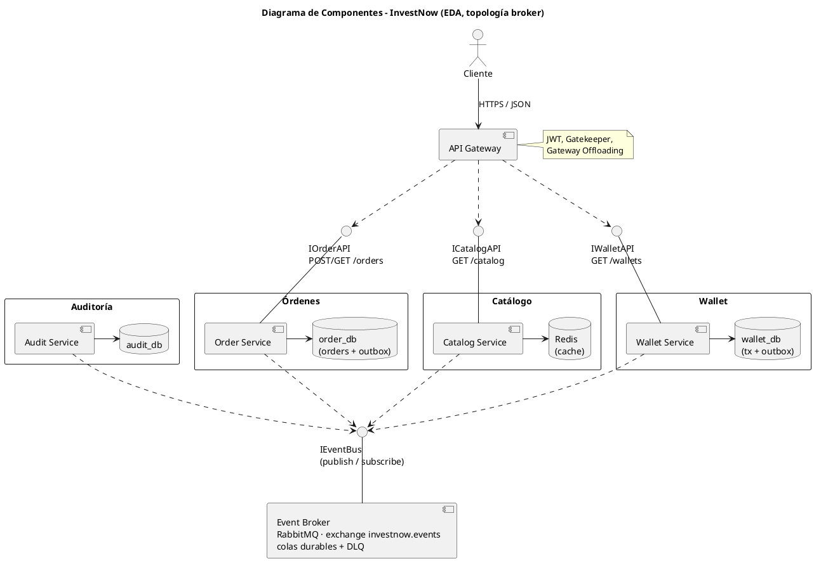
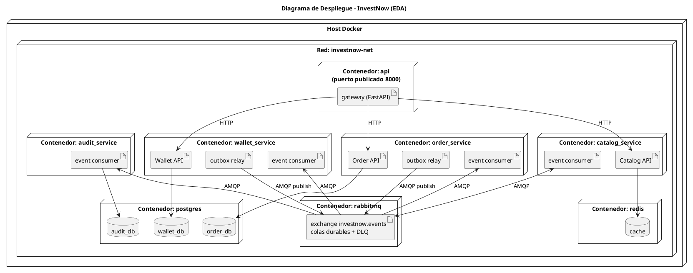
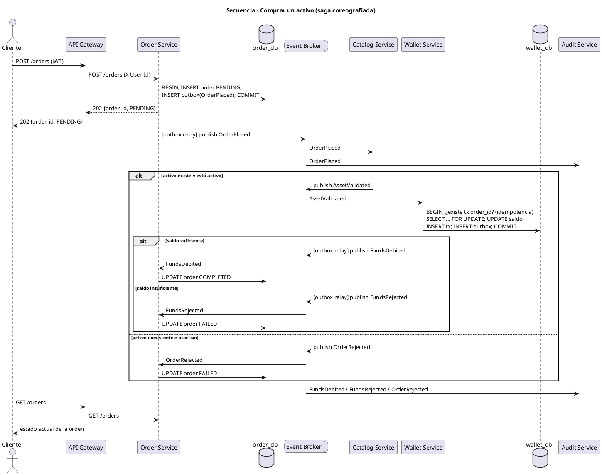
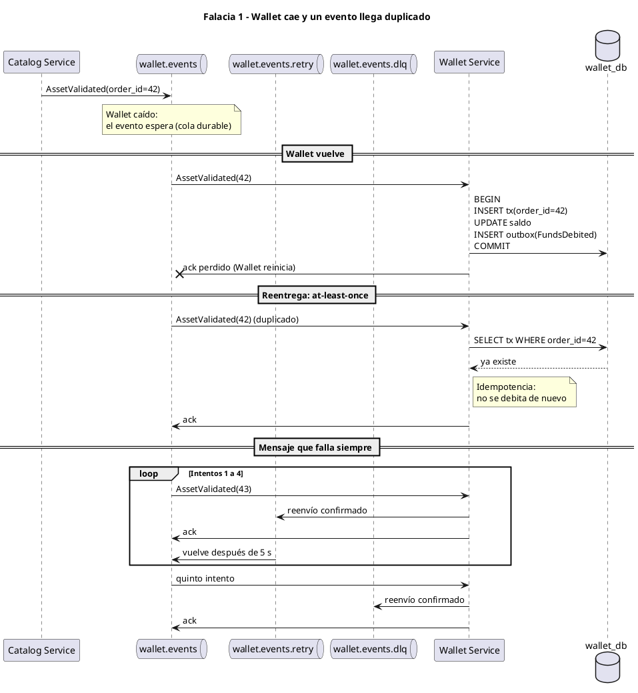

# TFU UT5 — Estilos de Arquitectura (InvestNow)

> Documento de entrega de la **Unidad Temática 5**, incremental sobre
> [`../UT4/ENTREGA.md`](../UT4/ENTREGA.md). Para la visión general del
> proyecto y cómo levantar el stack, ver el [`README.md`](../../README.md).

Los diagramas están en PlantUML: pegar cada bloque en
https://editor.plantuml.com para visualizarlo.

---

## Parte 1

### 1. Identificación y justificación del estilo arquitectónico

#### 1.1 Estilo anterior: Microservicios con orquestación sincrónica

La entrega de UT4 es una arquitectura de **microservicios** con partición
de dominio de primer nivel (Catálogo, Wallet, Órdenes) detrás de un API
Gateway. Sus rasgos principales:

- **Comunicación request/response (REST/JSON).** El `order_worker`
  orquesta la compra: llama a Catálogo para validar el activo y después a
  Wallet para debitar (`app/order_processing.py`). Conoce las URLs de los
  dos servicios y espera sus respuestas.
- **La cola no convierte al sistema en uno basado en eventos.** RabbitMQ se
  usa como *cola de trabajo* punto a punto (Queue-Based Load Leveling): el
  mensaje es un **comando** (“procesá esta orden”) con un único
  consumidor, que después sigue el flujo con llamadas sincrónicas.
- **Base de datos compartida.** Todos los servicios usan el mismo
  `DATABASE_URL`, así que el aislamiento de datos entre servicios queda
  incompleto.

#### 1.2 Nuevo estilo: Arquitectura Basada en Eventos (topología broker)

Se adopta una **Event-Driven Architecture con topología _broker_
(coreografía)**. Cada servicio reacciona a eventos de dominio que
publican los demás y, a su vez, publica eventos sobre lo que hizo. Ningún
componente central coordina el flujo.

| Cambio | Antes (UT4) | Ahora (UT5) |
|---|---|---|
| Coordinación de la compra | `order_worker` orquesta con llamadas HTTP | Coreografía: cada servicio reacciona a un evento y emite el siguiente |
| Tipo de mensaje | Comando a un único consumidor | **Evento de dominio** en pasado (`OrderPlaced`, `FundsDebited`…) publicado en un *topic exchange* con N suscriptores |
| Acoplamiento de Órdenes | Conoce y depende de Catálogo y Wallet | Solo conoce el broker y los eventos |
| Datos | Postgres compartido | Base lógica propia por servicio (`order_db`, `wallet_db`) |
| Publicación confiable | Doble escritura (DB, después cola) | **Transactional Outbox** en Órdenes y Wallet |
| Consistencia del flujo | Sincrónica dentro del worker | Eventual, mediante una **saga coreografiada** con eventos de compensación |

Las **consultas** (catálogo, saldo, historial de órdenes) siguen siendo
REST sincrónico a través del Gateway: el usuario necesita una respuesta
inmediata y no hay efectos secundarios que propagar.

#### 1.3 Por qué EDA y no SOA

1. **El dominio es asincrónico por naturaleza.** Una orden de inversión
   pasa por estados (pendiente → ejecutada/rechazada) y ya se acepta con
   `202 Accepted`. Modelar la compra como una cadena de eventos refleja el
   negocio mejor que una orquestación sincrónica.
2. **Disponibilidad ante fallas parciales.** Hoy, si Wallet está caído,
   el worker agota los reintentos y la orden queda `FAILED`. Con eventos,
   el evento espera en la cola durable de Wallet y se procesa cuando el
   servicio vuelve: la orden demora, pero no falla.
3. **Extensibilidad.** Las funcionalidades previstas (notificaciones,
   auditoría regulatoria, actualización de portafolio) son consumidores
   nuevos de eventos existentes y no requieren modificar a los productores.
   En SOA, cada una implicaría sumar una llamada a la orquestación del ESB
   o del servicio coordinador.
4. **Auditoría.** En una aplicación que mueve dinero, el flujo de eventos
   de dominio deja una traza de qué pasó y en qué orden.
5. **SOA no se ajusta al tamaño del sistema.** Su fortaleza es integrar
   sistemas heterogéneos de una organización mediante un bus y contratos
   corporativos. InvestNow tiene pocos servicios propios: un ESB agregaría
   un punto central de acoplamiento y falla sin un problema que lo
   justifique.

**Sobre el riesgo de perder un evento (y con él una transacción).** El
grupo evaluó este riesgo, que es la objeción principal a EDA en un sistema
financiero. Se mitiga con decisiones de diseño, sin abandonar el estilo:
colas durables y mensajes persistentes, *publisher confirms*, *ack*
manual, **Transactional Outbox** (no se pierde un evento entre el commit y
la publicación), **consumidores idempotentes** (el débito usa `order_id`
como clave, así que reprocesar no genera un doble cobro) y una **Dead
Letter Queue** para mensajes que fallan de forma repetida. El resultado es
una entrega *at-least-once* con procesamiento idempotente. SOA no evita
este problema: una llamada sincrónica que falla por timeout después de
debitar deja el mismo estado ambiguo y necesita los mismos mecanismos.

#### 1.4 Reflejo en la organización de la solución

- **Order Service:** recibe la intención de compra, la persiste junto con
  el evento `OrderPlaced` (outbox) y mantiene el estado de la orden
  reaccionando a los eventos de resultado. Desaparece el `order_worker`
  como orquestador.
- **Catalog Service:** además de su API de consulta, consume `OrderPlaced`
  y publica `AssetValidated` u `OrderRejected`.
- **Wallet Service:** consume `AssetValidated`, debita de forma atómica e
  idempotente, y publica `FundsDebited` o `FundsRejected` (outbox).
- **Audit Service (nuevo):** consumidor puro de `order.*` y `wallet.*`.
  Demuestra que se puede extender el sistema sin modificar a los
  productores.
- **Event Broker (RabbitMQ):** *topic exchange* `investnow.events`, una
  cola durable por consumidor y una DLQ por cola.
- **API Gateway:** mantiene autenticación, Gatekeeper y proxy (UT4).

---

### 2. Modelado de la nueva arquitectura

#### 2.1 Diagrama de componentes

Para no recargar el diagrama, los eventos que publica y consume cada
servicio se detallan en la tabla:

| Componente | Responsabilidad | Interfaz provista | Eventos publicados | Eventos consumidos |
|---|---|---|---|---|
| API Gateway | Punto de entrada, autenticación, autorización, ruteo | REST público `:8000` | — | — |
| Order Service | Ciclo de vida de la orden | `POST /orders`, `GET /orders` | `OrderPlaced` | `OrderRejected`, `FundsDebited`, `FundsRejected` |
| Catalog Service | Activos operables y su estado | `GET /catalog` | `AssetValidated`, `OrderRejected` | `OrderPlaced` |
| Wallet Service | Saldo y movimientos atómicos | `GET /wallets` | `FundsDebited`, `FundsRejected` | `AssetValidated` |
| Audit Service | Traza inmutable de eventos | — | — | `order.*`, `wallet.*` |
| Event Broker | Ruteo y persistencia de eventos, DLQ | AMQP | — | — |

Cada evento lleva un sobre común: `event_id` (UUID, para deduplicar),
`event_type`, `occurred_at`, `correlation_id` (= `order_id`) y `payload`.

#### 2.2 Diagrama de despliegue

Solo el Gateway publica un puerto al host. Cada servicio corre en su
propio contenedor y se escala de forma independiente: varias réplicas de
un consumidor comparten su cola (*competing consumers*). En la demo, las
tres bases lógicas comparten una instancia de Postgres para simplificar
el despliegue. Ningún servicio accede a la base de otro.

#### 2.3 Diagrama de secuencia — Comprar un activo

Es el caso de uso más significativo: mueve dinero y atraviesa todos los
servicios.

Cuando el procesamiento sale bien, el consumidor confirma (*ack*) el
mensaje después de terminar su trabajo. Si hay una falla técnica, publica
el mensaje en la cola de reintento y espera la confirmación del broker
antes de dar el *ack*. Si se agotan los intentos o el error es permanente,
lo envía a la DLQ.

---

### 3. Comparación entre estilos arquitectónicos

#### 3.1 Diferencias principales

| Dimensión | Microservicios + orquestación sincrónica (UT4) | EDA con topología broker (UT5) |
|---|---|---|
| **Distribución de responsabilidades** | La lógica del flujo de compra está centralizada en el worker de Órdenes, que conoce a Catálogo y Wallet | Distribuida: cada servicio decide qué hacer ante un evento. El flujo surge de la coreografía |
| **Comunicación** | REST sincrónico punto a punto. La cola solo desacopla la recepción de la orden | Eventos asincrónicos publish/subscribe por un broker. REST solo para consultas |
| **Acoplamiento** | Temporal (Wallet tiene que estar disponible al momento) y de ubicación (URLs) | Solo al contrato del evento y al broker |
| **Datos** | Postgres compartido | Base lógica por servicio, consistencia eventual entre servicios |
| **Despliegue** | 4 servicios + worker + Postgres + Redis + RabbitMQ | Servicios con consumidores y outbox relay propios, servicio de auditoría nuevo, colas y DLQ por consumidor |
| **Disponibilidad** | Una falla de Wallet o Catálogo hace fallar la orden | Las órdenes esperan en la cola hasta que el servicio vuelve |
| **Escalabilidad** | Escala el worker, pero lo limitan las llamadas sincrónicas | Cada consumidor escala por separado según el largo de su cola |
| **Rendimiento** | Menor latencia de punta a punta (sin saltos por el broker) | Mejor latencia percibida (202 inmediato) y mayor throughput. Más latencia total |
| **Consistencia** | Más fácil de razonar: el resultado se conoce en un solo lugar | Eventual. Requiere saga, idempotencia y conciliación |
| **Modificabilidad** | Agregar un paso implica modificar al orquestador | Agregar un consumidor no modifica a los productores |
| **Testeabilidad y observabilidad** | Flujo lineal, fácil de seguir y depurar | Flujo distribuido. Requiere `correlation_id`, trazas y monitoreo de colas |

#### 3.2 Pros y contras

**Microservicios con orquestación sincrónica (anterior)**

- ✅ Flujo explícito en un solo lugar, fácil de entender y depurar.
- ✅ Menos infraestructura y menos conceptos (sin outbox, saga ni DLQ).
- ✅ El resultado de cada paso se conoce de inmediato.
- ❌ Acoplamiento temporal: la disponibilidad de una compra es el producto
  de la disponibilidad de Órdenes, Catálogo y Wallet.
- ❌ El orquestador crece con cada funcionalidad nueva.
- ❌ La base compartida acopla los servicios a nivel de datos.

**EDA con topología broker (nueva)**

- ✅ Alto desacoplamiento y tolerancia a fallas parciales.
- ✅ Extensible sin modificar a los productores (Audit Service).
- ✅ Escalado independiente por consumidor y absorción de picos.
- ✅ Traza de auditoría natural en un dominio financiero.
- ❌ Consistencia eventual: el usuario ve `PENDING` hasta que la saga
  termina.
- ❌ Más complejidad: outbox, idempotencia, DLQ, orden de eventos,
  versionado de contratos.
- ❌ Flujo implícito, más difícil de seguir. Si hay muchos pasos, la
  coreografía se vuelve difícil de visualizar.
- ❌ El broker pasa a ser infraestructura crítica (se mitiga con
  persistencia y clúster en producción).

#### 3.3 Compromisos asumidos

- **Disponibilidad, escalabilidad y modificabilidad a cambio de
  consistencia inmediata y simplicidad.** Se acepta porque la orden ya era
  asincrónica para el usuario (UT4 respondía `202`). Lo que no se negocia
  es la **atomicidad del dinero**: cada débito sigue siendo una
  transacción ACID local en Wallet. Solo la coordinación *entre*
  servicios es eventual.
- **Coreografía en lugar de orquestación.** Con tres pasos, la coreografía
  se puede seguir y evita reintroducir un coordinador central. Si el flujo
  crece (por ejemplo, venta, liquidación o integración con un broker
  externo), conviene migrar a una topología *mediator* o a una saga
  orquestada.
- **Más infraestructura y complejidad operativa a cambio de garantías de
  entrega.** Outbox, DLQ e idempotencia son el costo de usar eventos en un
  sistema que mueve dinero.
- **Mayor latencia de punta a punta a cambio de mayor throughput y
  resiliencia.** Cada salto por el broker agrega latencia, pero el cliente
  no la percibe en la aceptación de la orden.

---

### 4. Falacias de la computación distribuida y patrones arquitectónicos

Pasar a EDA multiplica las interacciones por red: cada paso de la compra
es ahora un mensaje entre procesos. Se analizan las tres falacias que más
afectan a la solución, siguiendo la relación falacia → riesgo → patrón
vista en clase (Richards & Ford, 2020).

| Falacia | Riesgo en InvestNow | Patrones y decisiones |
|---|---|---|
| **1. La red es confiable** | Pérdida o duplicación de eventos → orden sin procesar o **doble débito** | Queue-Based Load Leveling (colas durables), Retry con DLQ, Transactional Outbox, consumidor idempotente |
| **2. La latencia es cero** | El usuario espera mientras la saga atraviesa 3 servicios. Las lecturas que cruzan servicios suman latencia | Procesamiento asíncrono (`202` + eventos), CQRS (comandos por eventos, consultas locales), Cache-Aside |
| **3. La red es segura** | Un tercero publica eventos falsos en el broker (por ejemplo, un `FundsDebited` forjado) o accede directo a un servicio interno | Gatekeeper (UT4), broker y bases sin puertos expuestos, credenciales por servicio |

#### 4.1 Falacia 1: La red es confiable

**Problema.** Entre que un servicio hace commit y el evento llega al
siguiente consumidor hay cuatro puntos de falla: el proceso muere después
del commit y antes de publicar, el broker cae, el consumidor muere antes
del *ack* o el *ack* se pierde. Los dos primeros **pierden** el evento (la
orden queda `PENDING` para siempre). Los dos últimos lo **duplican**: el
broker lo reentrega y, sin protección, Wallet debitaría dos veces. En una
app financiera ambos resultados son inaceptables.

**Decisiones y patrones:**

- **Transactional Outbox.** Order y Wallet guardan el evento en una tabla
  `outbox` en **la misma transacción** que el cambio de negocio. Un relay
  lo publica después con *publisher confirms* y lo marca como enviado
  recién cuando el broker confirma. Si algo falla, el relay reintenta. Así
  se elimina la doble escritura DB → cola que hoy existe en
  `order_router.py`.
- **Queue-Based Load Leveling.** Una cola durable por consumidor con
  mensajes persistentes. Si Wallet está caído, los eventos se acumulan y
  se procesan cuando vuelve. La falla se convierte en demora.
- **Retry + Dead Letter Queue.** Ante una falla técnica, el consumidor
  publica el mensaje en la cola de reintento. Cinco segundos después,
  RabbitMQ lo devuelve a la cola principal. Si falla en el quinto intento
  o el error es permanente, el consumidor lo manda a la DLQ para revisar
  qué pasó. El consumidor da el *ack* cuando el broker confirma que recibió
  el mensaje reenviado.
- **Consumidor idempotente.** El outbox y el retry garantizan entrega
  *at-least-once*, así que los duplicados son esperables. Wallet usa
  `order_id` como clave única del movimiento: un `AssetValidated`
  repetido devuelve el resultado original sin volver a debitar. Los demás
  consumidores deduplican por `event_id`.

**Justificación.** Retry y Queue-Based Load Leveling son los patrones que
el curso asocia a esta falacia. Outbox e idempotencia los complementan
para que el *at-least-once* sea seguro con dinero. Se descarta
*exactly-once* a nivel de broker por costoso y frágil: se obtiene el mismo
efecto de negocio con at-least-once más idempotencia.

#### 4.2 Falacia 2: La latencia es cero

**Problema.** En UT4, el worker hace dos llamadas HTTP encadenadas
(Catálogo y Wallet), cada una con reintentos y backoff. Si el diseño
supusiera latencia cero, el cliente esperaría todo ese tiempo bloqueado.
Además, si cada consulta del usuario (por ejemplo, el historial de
órdenes) tuviera que consultar a otros servicios para armar la respuesta,
la latencia de lectura se sumaría salto a salto.

**Decisiones y patrones:**

- **Procesamiento asíncrono.** `POST /orders` solo escribe en la base
  local de Order (orden + outbox) y responde `202`. El tiempo de respuesta
  no depende de Catálogo ni de Wallet. La latencia de la saga existe, pero
  queda fuera del camino crítico del usuario.
- **CQRS.** Se separan los dos caminos. Los **comandos** (comprar) viajan
  como eventos. Las **consultas** (`GET /orders`, `GET /wallets`) se
  responden **solo con datos locales** de cada servicio, que se mantienen
  actualizados consumiendo eventos (el estado de la orden en `order_db` lo
  actualizan `FundsDebited`, `FundsRejected` y `OrderRejected`). Ninguna
  lectura cruza servicios.
- **Cache-Aside** (UT4) en `GET /catalog`, la lectura más frecuente.

**Justificación.** Son las recomendaciones del curso para esta falacia
(caché y procesamiento asíncrono; Cache-Aside y CQRS). Con CQRS, la
consistencia eventual queda explícita: el usuario ve `PENDING` hasta que
llega el evento de resultado, algo aceptable porque una orden de inversión
ya es un proceso con estados.

#### 4.3 Falacia 3: La red es segura

**Problema.** En EDA, el broker es un canal que todos los servicios
consideran confiable: si alguien publica un `FundsDebited` falso, Order
marcaría como pagada una orden que nunca se cobró. En el Compose de UT4,
RabbitMQ y Postgres publicaban puertos en el host.

**Decisiones y patrones:**

- **Gatekeeper + Gateway Offloading (UT4).** Siguen siendo el único punto
  de entrada. Autentican el JWT antes de que cualquier pedido llegue a un
  servicio.
- **Broker y bases solo en la red interna.** Se dejan de publicar sus
  puertos al host.
- **Credenciales por servicio en RabbitMQ.** Cada servicio puede leer
  su propia cola y publicar únicamente en las claves que le corresponden.
  Por ejemplo, Catálogo puede publicar `order.asset_validated` y
  `order.rejected`. Solo Wallet puede publicar `wallet.funds_debited` y
  `wallet.funds_rejected`. Audit escucha los eventos y solo publica en
  sus destinos de reintento y DLQ.
- **Contexto de usuario solo desde el Gatekeeper.** El Gateway descarta
  los headers `X-User-Id` y `X-User-Roles` que envía el cliente y los
  reemplaza por los del JWT. El SOAP de Wallet rechaza consultar una
  billetera distinta de la del usuario autenticado.

`scripts/demo_ut5_seguridad.sh` verifica estas decisiones contra el stack
levantado.

#### 4.4 Representación en los modelos

- **Componentes (2.1):** las bases `order_db` y `wallet_db` incluyen la
  tabla `outbox`. El broker contiene las colas durables y las DLQ.
- **Despliegue (2.2):** el outbox relay y el consumidor de eventos de
  cada servicio aparecen como artefactos dentro de su contenedor. Solo el
  Gateway publica un puerto al host.
- **Secuencia (2.3 y 4.1):** la escritura atómica orden + outbox, el *ack*
  posterior al commit, la reentrega con chequeo de idempotencia y el
  pasaje a DLQ.

---

### 5. Atributo de calidad: Disponibilidad

#### 5.1 Qué se espera mejorar

Se elige **disponibilidad**, entendida como la capacidad del caso de uso
*Comprar un activo* de completarse aunque un servicio del que depende
esté caído temporalmente. Es el atributo más afectado por el cambio de
estilo y el más crítico para el negocio: en una plataforma de inversión,
una orden rechazada por una falla interna es una operación perdida.

En UT4, la cola ya permitía **aceptar** la orden con Wallet caído, pero no
**completarla**: el worker reintenta 3 veces (backoff de 1 s y 2 s,
`app/resilience/retry.py`) y después marca la orden `FAILED`. Así, una
caída de Wallet de más de unos 3 segundos hace fallar todas las órdenes
que se procesen en ese lapso, y el usuario tiene que volver a enviarlas.

**Escenario de calidad**

| Elemento | Valor |
|---|---|
| Fuente | Falla interna de infraestructura |
| Estímulo | `wallet_service` deja de responder durante 60 s |
| Artefacto | Caso de uso *Comprar un activo* (Order, Catalog, Wallet) |
| Entorno | Operación normal, con órdenes entrando de forma continua |
| Respuesta | Las órdenes se aceptan, quedan `PENDING` y se completan cuando Wallet vuelve, sin pérdidas ni débitos duplicados |
| Medida | 100 % de órdenes aceptadas, 100 % completadas tras la recuperación, 0 perdidas, 0 duplicadas |

#### 5.2 Cómo contribuyen las decisiones arquitectónicas

| Decisión | Contribución a la disponibilidad |
|---|---|
| Comunicación por eventos (sin llamadas sincrónicas en la compra) | Elimina el acoplamiento temporal: Order no necesita que Wallet esté vivo para aceptar ni para avanzar la orden |
| Colas durables por consumidor | La caída de un servicio se convierte en **demora**, no en falla. Los eventos esperan |
| Transactional Outbox | Ninguna orden aceptada queda sin su evento, aunque el broker o el servicio caigan |
| Retry con DLQ | Las fallas técnicas tienen hasta cinco intentos. Los errores permanentes van directo a la DLQ. Si un consumidor está apagado, los mensajes esperan en su cola |
| Consumidor idempotente | Hace seguras las reentregas que provoca la recuperación |
| Base por servicio | La falla o carga de una base no detiene a los demás servicios |

**Compromiso asumido:** mejora la disponibilidad, pero empeora el tiempo
total hasta que la orden queda `COMPLETED` durante una caída (consistencia
eventual). Se acepta porque es preferible una orden demorada a una orden
perdida.

#### 5.3 Experimentos y resultados

Se ejecutaron los experimentos sobre la arquitectura UT4 (commit
`7373fdf`) y sobre UT5 con `scripts/demo_ut5_disponibilidad.sh`. Cada
prueba de caída aceptó 50 órdenes, una por segundo; el servicio se detuvo
después de las primeras 10 y se recuperó tras 60 segundos. La línea base
se ejecutó en un volumen Compose aislado. P2 de UT4 reenvió el mismo
comando de orden para comprobar la clave idempotente `order:{order_id}`;
P2 de UT5 terminó el consumidor Wallet durante una entrega sin ack y
verificó la reentrega.

| # | Prueba | Procedimiento | Métricas |
|---|---|---|---|
| P1 | **Caída de Wallet** | Enviar 50 órdenes válidas (1 por segundo). A los 10 s, `docker compose stop wallet_service`. A los 70 s, `start`. Esperar a que se vacíen las colas | % de `202` aceptadas, % `COMPLETED` y `FAILED` finales, órdenes perdidas (aceptadas sin estado final), tiempo hasta drenar la cola |
| P2 | **Reentrega e idempotencia** | UT4: reenviar el mismo comando de orden. UT5: matar Wallet mientras tiene una entrega sin ack y verificar su reentrega | Filas en `wallet_transactions` por `order_id` y saldo final = saldo inicial − Σ órdenes completadas |
| P3 | **Caída de Catalog** | Igual que P1, pero deteniendo `catalog_service` | Mismas métricas que P1 |
| P4 | **Mensaje irrecuperable** | Publicar un evento malformado | El mensaje va directo a la DLQ y el consumidor sigue procesando otros eventos |

**Resultados medidos**

| Prueba / métrica | UT4 (`7373fdf`) | UT5 |
|---|---|---|
| P1 — Wallet: órdenes aceptadas | 50/50 (100 %) | 50/50 (100 %) |
| P1 — Wallet: estado final | 48 `COMPLETED`, 2 `FAILED`, 0 pendientes/perdidas | 50 `COMPLETED`, 0 `FAILED`, 0 pendientes/perdidas |
| P1 — Wallet: débitos/transacciones | 48 | 50, una por orden |
| P1 — drenaje después de recuperar Wallet | 6,4 s | 44 s, incluyendo la espera de 45 s usada para forzar la reentrega |
| P2 — idempotencia | Reenvío del mismo comando: 1 fila en `wallet_transactions`; el saldo permaneció en 9951,00 | Wallet se terminó con una entrega sin ack; 50 órdenes completadas y 50 transacciones únicas |
| P3 — Catalog: órdenes aceptadas | 50/50 (100 %) | 50/50 (100 %) |
| P3 — Catalog: estado final | 48 `COMPLETED`, 2 `FAILED`, 0 pendientes/perdidas | 50 `COMPLETED`, 0 `FAILED`, 0 pendientes/perdidas |
| P3 — drenaje después de recuperar Catalog | 4,3 s | 3 s |
| P4 — evento malformado | No aplica: UT4 no usa eventos ni DLQ | La DLQ de Catalog aumentó en 1 y el consumidor procesó el siguiente evento válido |

En UT5, las dos pruebas de caída conservaron el 100 % de las órdenes y
las completaron tras recuperar el servicio; no hubo débitos duplicados.
La latencia adicional es intencional: se prefiere demorar el procesamiento
a marcar la orden como fallida. El drenaje P1 incluye la pausa de base de
datos usada para interrumpir Wallet con una entrega en curso y verificar
el reenvío del mensaje.
